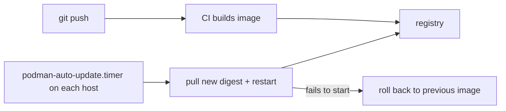

# Sprite architecture

A shared core for discord.py bots ("sprites"), plus how they are packaged and deployed. Parts not yet built are
marked planned.

## Repositories

| Repo | Contains |
|---|---|
| sprite-compile | core library (Python package), base image; dev template (Copier, planned) |
| sprite-register | planned: instance template (Copier), deploy and secrets tooling |

Each bot lives in its own repo; local work uses an editable install of sprite-compile. Decisions and their rationale
are in [adr/](adr/README.md).

Naming follows Shadowrun's resonance skills: a technomancer *compiles* a sprite (creates it) and *registers* it (binds
it for long-term service).

## sprite-compile

### Library
The core (config, secrets, storage, codec, `run()`) knows nothing about Discord. Discord support lives in
`sprite_compile.discord`; other chat platforms (Telegram, Slack, …) would be sibling frontends. One process can run
several frontends sharing one database. `discord.py` becomes an optional extra once a second frontend exists.

- `run(app_name, ConfigModel, SECRETS, make_frontends)`: the bot's whole command line. Logging (`$LOG_LEVEL`; no
  timestamps under systemd), config, secrets, `make_frontends(config, secrets)`, every frontend's `prepare()`, READY,
  then every frontend's `serve()`; `config sync|check` and `secrets list` as subcommands. A frontend whose `serve()`
  fails is retried on its own (5 s, doubling up to 10 min; back to 5 s after it ran 10 min) while the others keep
  running.
- `sprite_compile.discord.sprite.DiscordSprite(commands.Bot)`, the Discord frontend: `prepare()` loads the extensions
  it lists in `extension_names`; `serve()` logs in. Guild and/or global command registration, application emoji sync
  from package assets (read lazily, with per-name fallbacks), username sync. Its steps are also plain functions, for
  bots that don't fit the base class. Shared settings (`guild_id`, `global_commands`, `username`) come from
  `DiscordSettings`, embedded as `[discord]`; bots add `DISCORD_SECRETS` (the `discord_token`) to their `SECRETS`.
  `UserAvatarCache` (`sprite_compile.discord.avatars`) keeps users' names and avatars per guild.
- Storage: SQLite only, in the instance's `data/` (`open_databases`): `state.sqlite3` (typed tables, int or str
  keys) and `cache.sqlite3`, which is always safe to delete. `ExpiringTable`s (rows with `expires_at`, purged on open
  and by `purge_expired()`) work in either. A row that doesn't decode is logged and reads as missing. No JSON state
  files. The base image sets `SPRITE_DATA_DIR` to the data mount; without it (development) the databases go to the
  platformdirs state and cache dirs.
- Codec (`sprite_compile.codec`): registered dataclasses ↔ tagged plain data for msgpack; enums by member name;
  msgspec-native values (datetime, timedelta, UUID, sets, …) rebuilt from field type hints. Bots build the registry
  with `build_registry(packages)`, which runs `check_hints()` and fails on field types the codec can't round-trip; a
  bot's test suite should build its full registry once. Dataclasses sprite-compile stores itself (e.g.
  `MessageHandle`) are registered with every codec via `@library_type(tag)`; a bot class under one of their tags is
  rejected, and so is a second class under a tag (or alias) another class already has.
- `config sync` / `config check` and `secrets list` as subcommands of each bot's own command (`run()` dispatches
  them; see below).
- UX primitives (components v2: `LayoutView`, `Container`, `ui.Label`). Items marked done exist; the rest are planned:
  - Persistent buttons (`PersistentButton`, done): `DynamicItem`s whose `custom_id` (prefix plus typed fields, at
    most 100 characters) carries identifiers like a record ID, so they survive restarts; the data stays in the
    database. An `allowed()` gate per button with an ephemeral refusal. Classes register themselves when defined.
  - Views (`ContainerView`, done): a `LayoutView` with one `Container`, and text/separator/section/button helpers that
    pack buttons five to a row.
  - Pagination (planned): packing content into several `LayoutView` messages under Discord's 40-component,
    30-interactive and 4000-character limits; page buttons.
  - Notes kept across re-renders (planned): a `TextDisplay` with a fixed `id`, read back via `walk_children()`.
  - Progress messages (planned) with rate-limited edits and a progress-callback shape.
  - Editing a message the bot sent earlier (done): through an interaction token stored per message in the cache
    database (`MessageHandles`; also across a restart and where the bot can't see the channel), falling back to
    `get_partial_message` with the bot token once the token has expired.
  - Interaction helpers (done): defer-if-needed, ephemeral followup menus that delete themselves before their token
    expires and are rebuilt at the next start if a restart interrupts them (`MessageHandles.restore_menus` with the
    bot's builder, from the stored `MenuOrigin`: the message it was opened from and who opened it), menu updates.
  - Multi-message cards (planned): post / re-render / delete a card spanning several messages.
  - Validated modal inputs (`ValidLabel` wrappers with `validate()`: numbers, checkbox, radio and checkbox groups) and
    `BuiltModal`, whose fields are keyword arguments and whose `on_submit` gets the values by name (done).
  - Command definitions from typed functions (done; `sprite_compile.discord.commands`): `@command`, with signatures
    synthesized from `Annotated[..., Desc(...)]` and `Choices`; each command hands `(interaction, function,
    arguments)` to the bot's `invoke`. `build_command_group` builds one top-level group from a package (subgroups from
    module paths, configurable name prefix stripping) and/or an explicit function list, with duplicate checks.
  - Guild + global registration (done) with a fresh `Command`/`Group` per registration (a command has one parent) and
    `allowed_contexts`.
  - `key=value` argument autocomplete (planned) with alias, prefix and Levenshtein matching.
  - Emojis (done): sync that warns and skips instead of failing, per-name unicode fallback.
  - Keyed single-flight (planned): per-key `asyncio.Event` claims so two messages don't do the same work.
  - Serialization (done): a tagged-dataclass codec with type-hint-driven decoding.

Python 3.14. Published both as a Python package (for `uv run` and tests without containers) and as the base image.

### Base image
```
python:3.14-slim
└─ sprite-compile:X.Y      discord.py, msgspec, pillow, platformdirs, tomlkit, sprite_compile
   ├─ bot-a                bot code + its own deps
   └─ bot-b
```
Bots on the same base tag share its layers on disk. Old tags stay in the registry, so a bot can stay on one. Bot
Containerfiles install their deps constrained to the versions already in the base, never upgrading them
(`-c /opt/venv/constraints.txt`, exported from `uv.lock`).

The base installs sprite-compile and its locked deps into `/opt/venv` (on `PATH`) and runs as user `sprite` (UID
1000). Mount points: the data dir at `/data` (`SPRITE_DATA_DIR`), the config at `/config/config.toml`
(`SPRITE_CONFIG`; its own directory so sync can replace the file), secrets at `/run/secrets` (`SPRITE_SECRETS_DIR`).
Build: `podman build -t localhost/sprite-compile:0.1 .` in the repo root.

uv is not in the base. Bot Containerfiles bind-mount it for their install step only and install as root (the venv is
root's; the bot runs as `sprite`). `--no-sources` makes the bot use the base's sprite-compile instead of the path
source its `pyproject.toml` has for development:
```dockerfile
USER root
RUN --mount=from=ghcr.io/astral-sh/uv:<version>,source=/uv,target=/bin/uv \
    uv pip install --python /opt/venv/bin/python --no-sources --compile-bytecode -c /opt/venv/constraints.txt /src
USER sprite
```

### Dev template (planned)
Copier template in this repo, versioned by the same git tags as the library. Will generate what each bot repo must
contain itself: `pyproject.toml`, Containerfile (`FROM sprite-compile:X.Y`), CI workflow, `config` model skeleton, test
setup.
`copier update` merges later template changes into existing bots, keeping local edits.

## Config

- One `config.toml` per instance. Defaults live in code (msgspec structs); the file holds only what differs.
- Strict validation at startup: unknown keys and missing required keys are errors naming the key.
- The base image sets `SPRITE_CONFIG` to the mounted file; without it (development) it is `config.toml` in the
  platformdirs config dir. A missing file counts as empty.
- Every field declares its description and the bot version that added it; `check_settings()` fails on fields
  without one (a bot's test suite runs it):
  ```python
  max_playlist_items: Annotated[int, Setting("Maximum entries taken from one playlist link.", added="0.4.0")] = 100
  ```
- `<bot> config sync` (tomlkit, preserves comments and formatting) adds every missing key **commented out**, with
  its description, its default and the version that added it, so the code default keeps applying until uncommented:
  ```toml
  # Maximum entries taken from one playlist link. (added in 0.4.0)
  # max_playlist_items = 100
  ```
  Keys already present as comments count as present. Keys the code no longer knows are commented out with a
  `# removed in <bot version>:` note (left in, they would fail validation).
- `<bot> config check` writes nothing; it fails on validation errors and when the file is out of sync.
- Sync runs automatically before every start (`ExecStartPre=`), non-interactive, as a one-shot container with the
  config's directory writable (sync replaces the file atomically). The bot's own container mounts the config
  read-only.

## Secrets

- Declared in code per bot, like config:
  ```python
  SECRETS = {
      "discord_token": Secret("Bot token from the Developer Portal"),
      "gmail_oauth": Secret("OAuth client JSON", required=False),
  }
  ```
- Stored as Podman secrets named `<instance>.<name>`, mounted read-only at `/run/secrets/<name>`. Never in the
  environment, `podman inspect`, Copier answers, or git. The base image sets `SPRITE_SECRETS_DIR=/run/secrets`;
  without it (development) each secret is a file in `secrets/` in the platformdirs config dir. A missing or empty
  file counts as not set; the trailing newline is stripped.
- `sprite-register secrets <instance>`: reads the declarations from the image, shows each as set / missing / optional,
  prompts for missing ones with hidden input. `secrets set <instance> <name>` rotates one
  (`podman secret create --replace`) and restarts the instance.
- The pre-start step only reports: a missing required secret fails the start with a message naming it and the command
  to fix it (`sprite-register secrets <instance>`; the quadlet passes the instance name as `SPRITE_INSTANCE`). `<bot>
  secrets list` shows each declared secret as set / missing / not set (optional), never the values, and exits 1 when
  a required one is missing.
- Podman's default driver stores secrets unencrypted, root-only, under `/var/lib/containers`.

## Runtime and isolation

Rootful Podman, managed with sudo, with per-container hardening in each quadlet:

- `UserNS=auto`: each container gets its own unprivileged UID range matching no real account. An escape lands as a
  nobody with no home and no sudo, and containers can't read each other's files.
- `ReadOnly=true`, `DropCapability=all`, `NoNewPrivileges=true`; only the instance's data dir is writable.
- One image store (`/var/lib/containers`), so base layers are stored once per host.
- Logs go to journald.

Requires Podman ≥ 5.3.0 (directory symlink below). Runs on any systemd distro with Podman: Ubuntu, Fedora, NixOS,
Arch. During development, run the same images locally, or `uv run`.

## sprite-register: instances

Every deployed bot is an instance, created from the instance template with Copier (name, image, guild ID, …) and kept
in one directory:

```
/srv/sprites/<instance>/
  <instance>.container     quadlet
  config.toml
  data/                    the instance's state, the only writable mount
  .copier-answers.yml      no secrets in here
```

`copier update` refreshes the quadlet when the template's hardening improves. Any bot can have several instances.

Quadlet picks the units up through one directory symlink, `/etc/containers/systemd/sprites -> /srv/sprites`.
Rules that follow from it:
- Absolute paths in `Volume=`, `EnvironmentFile=` etc.
- `/srv` is on the root filesystem (`findmnt /srv` prints nothing).
- No drop-ins: the template owns the whole unit file.
- No `podman quadlet install`.
- Check what the generator sees with `/usr/lib/podman/quadlet --dryrun`.

### Network

- All instances join one Podman network, `sprites` (`host/sprites.network` in sprite-register, installed once per
  host by host setup): DNS on, bridge `sprites0`, subnet `10.89.0.0/24`. Every instance quadlet sets `Network=`.
- Host check refuses the subnet when it overlaps a route the host already has (LAN, VPC, Docker).
- On hosts running Docker, host setup installs `sprites-docker-forward.service`, a oneshot unit (`After=`, `PartOf=`
  and `WantedBy=docker.service`) whose `ExecStart` inserts two `DOCKER-USER` rules accepting traffic from `sprites0`
  and established traffic back to it (checked with `iptables -C` first), and whose `ExecStop` deletes them. Host check
  verifies the rules with `iptables -C`; teardown disables the unit.

## Build and deploy



- The dev template's workflow targets GitHub Actions + ghcr.io; Forgejo Actions syntax is nearly the same. Switching
  registries is one line in each quadlet (`Image=`) plus the workflow's push target.
- Instances update through Podman's own `podman-auto-update` (`AutoUpdate=registry` and a fully qualified `Image=`).
  The stock rootful timer runs daily with up to 15 min random delay; override `OnCalendar=` for more often. Rollback is
  on by default: if restarting the unit doesn't succeed, the previous image is retagged and restarted.
- Quadlets use `Notify=true` (`--sdnotify=container`). `run()` writes `READY=1` to `$NOTIFY_SOCKET` once the config
  validated, the secrets loaded, the bot was built and its extensions loaded, before connecting to Discord. A start
  that fails (at the latest at `TimeoutStartSec`) is rolled back; the config sync/check `ExecStartPre=` runs the new
  image, so it is covered too.
- After READY, `run()` retries a failed frontend in-process with a growing delay while the bot's other frontends keep
  running. systemd restarts (`Restart=on-failure`, `RestartSec=`, `RestartSteps=`, `RestartMaxDelaySec=`; systemd
  ≥ 254) only cover crashes outside the frontends.
- Private images: root's registry login, `sudo podman login <registry>`, ends up in `/run/containers/0/auth.json`,
  which is cleared on reboot. Point auto-update at a persistent file instead (`io.containers.autoupdate.authfile` label
  or `REGISTRY_AUTH_FILE`).
- CI does not update instances directly. Optional: a per-host SSH key restricted in `authorized_keys` to
  `systemctl start podman-auto-update.service`, for updates seconds after a push.
